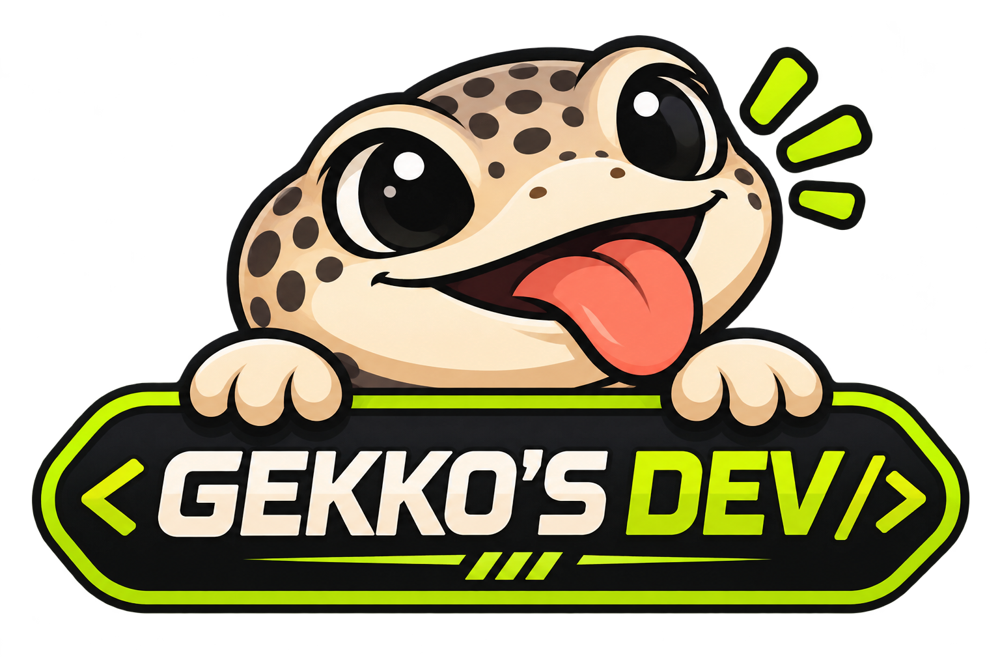

  

  <strong>Desenvolvimento de software, do planejamento aos detalhes finais.</strong>

  Web &nbsp;·&nbsp; Sistemas &nbsp;·&nbsp; Produtos digitais

  <a href="mailto:gekkosdev@gmail.com">Entre em contato</a>
  &nbsp;·&nbsp;
  <a href="https://github.com/orgs/gekkosdev/repositories">Conheça os repositórios</a>

---

## Quem somos

A **Gekko's Dev** nasceu da parceria de **Layla e Leo**. Somos um projeto independente de desenvolvimento de software, com interesse em criar ferramentas úteis, interfaces bem resolvidas e produtos que possam evoluir com o tempo.

Para nós, um bom projeto não termina quando o código funciona. Ele precisa fazer sentido para quem usa e continuar compreensível para quem vai mantê-lo.

## O que fazemos

**Desenvolvimento web**  
Sites e aplicações web com foco em estrutura, desempenho e facilidade de uso.

**Sistemas para negócios**  
Ferramentas digitais para organizar processos, informações e rotinas.

**Produtos próprios**  
Projetos autorais em que exploramos ideias, validamos soluções e aprimoramos nossa prática de desenvolvimento.

## Como trabalhamos

**01 / Entender** — Identificar o problema e organizar os requisitos antes de começar.

**02 / Planejar** — Definir o escopo, os fluxos e as decisões técnicas com clareza.

**03 / Construir** — Desenvolver por etapas, com organização e acompanhamento das mudanças.

**04 / Validar** — Testar, revisar e melhorar o que for necessário.

## Projetos e código aberto

Este é o espaço em que compartilhamos os projetos da Gekko's Dev destinados à publicação. Cada repositório terá sua própria documentação, histórico e instruções de uso, quando aplicável.

[**Explorar os repositórios da organização →**](https://github.com/orgs/gekkosdev/repositories)

---

### Vamos conversar?

Para falar sobre um projeto, parceria ou ideia, escreva para **[gekkosdev@gmail.com](mailto:gekkosdev@gmail.com)**.

  Gekko's Dev · Criada por Layla e Leo

